<a href="https://absc.uz">
  <picture>
    <source media="(prefers-color-scheme: dark)" srcset="../assets/banner-dark.svg" />
    
  </picture>
</a>

 

**🇷🇺 [Русский](#-о-нас)** &nbsp;·&nbsp; **en [English](#-about-us)**

 

## 👋 О нас

**ABSC** — продуктовая MedTech-компания из Ташкента. Мы создаём цифровые системы, которые снимают рутину с клиник и делают процессы понятнее — и для персонала, и для пациентов.

> *Продукты с заботой о людях.*

 

## 🩺 Продукты

<table>
<tr>
<td width="50%" valign="top">

### 🧠 [Synapse](https://synapse-system.uz)

Медицинская информационная система для клиник и больниц.

`Регистратура` `ЭМК` `Документооборот` `HR` `Склад` `Касса` `Запись пациентов`

Спроектирована с учётом стандартов качества и безопасности **JCI**.

**[synapse-system.uz →](https://synapse-system.uz)**

</td>
<td width="50%" valign="top">

### 🐾 [Synapse-Animals](https://synapse-animals.uz)

ERP-система для ветеринарных клиник — подход Synapse, адаптированный под ежедневную работу ветклиники.

`ERP` `Ветеринария`

 

**[synapse-animals.uz →](https://synapse-animals.uz)**

</td>
</tr>
</table>

 

## 🛠 Что мы делаем

<table>
<tr>
<td align="center" width="25%">💻 <b>Разработка</b> CRM, ERP и МИС</td>
<td align="center" width="25%">🎯 <b>Продуктовый дизайн</b> UX/UI сложных систем</td>
<td align="center" width="25%">🌐 <b>Веб-дизайн</b> сайты и лендинги</td>
<td align="center" width="25%">✨ <b>Брендинг</b> айдентика и стратегия</td>
</tr>
</table>

 

## 🤝 Партнёры

<table>
<tr>
<td align="center" width="50%">🏥 <b>AKFA Medline University Hospital</b></td>
<td align="center" width="50%">🏛 <b>Ассоциация медицинских организаций</b></td>
</tr>
</table>

 

## 📬 Контакты

| | |
|:--|:--|
| 🌐 **Сайт** | [absc.uz](https://absc.uz) |
| ✉️ **Email** | [contact@absc.uz](mailto:contact@absc.uz) |
| 📞 **Телефон** | [+998 77 114 06 26](tel:+998771140626) |
| 📍 **Адрес** | г. Ташкент, Мирзо-Улугбекский район, ул. Навнихол, 7 |

 

---

 

## 👋 About us

**ABSC** is a MedTech product company based in Tashkent, Uzbekistan. We build digital systems that take routine work off clinics and make processes clearer for both staff and patients.

> *Products built with care for people.*

 

## 🩺 Products

<table>
<tr>
<td width="50%" valign="top">

### 🧠 [Synapse](https://synapse-system.uz)

A medical information system for clinics and hospitals.

`Reception` `EMR` `Document flow` `HR` `Warehouse` `Cash desk` `Appointments`

Designed with **JCI** quality and safety standards in mind.

**[synapse-system.uz →](https://synapse-system.uz)**

</td>
<td width="50%" valign="top">

### 🐾 [Synapse-Animals](https://synapse-animals.uz)

An ERP system for veterinary clinics — the Synapse approach, adapted to the daily work of a vet clinic.

`ERP` `Veterinary`

 

**[synapse-animals.uz →](https://synapse-animals.uz)**

</td>
</tr>
</table>

 

## 🛠 What we do

<table>
<tr>
<td align="center" width="25%">💻 <b>Development</b> CRM, ERP & medical IS</td>
<td align="center" width="25%">🎯 <b>Product design</b> UX/UI for complex systems</td>
<td align="center" width="25%">🌐 <b>Web design</b> websites & landing pages</td>
<td align="center" width="25%">✨ <b>Branding</b> identity & strategy</td>
</tr>
</table>

 

## 🤝 Partners

<table>
<tr>
<td align="center" width="50%">🏥 <b>AKFA Medline University Hospital</b></td>
<td align="center" width="50%">🏛 <b>Association of Medical Organizations</b></td>
</tr>
</table>

 

## 📬 Contact

| | |
|:--|:--|
| 🌐 **Website** | [absc.uz](https://absc.uz) |
| ✉️ **Email** | [contact@absc.uz](mailto:contact@absc.uz) |
| 📞 **Phone** | [+998 77 114 06 26](tel:+998771140626) |
| 📍 **Address** | 7 Navnikhol St., Mirzo-Ulugbek district, Tashkent, Uzbekistan |

 

© ABSC · MedTech, made with care for people

